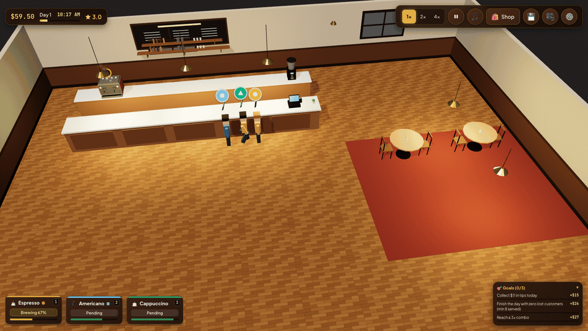
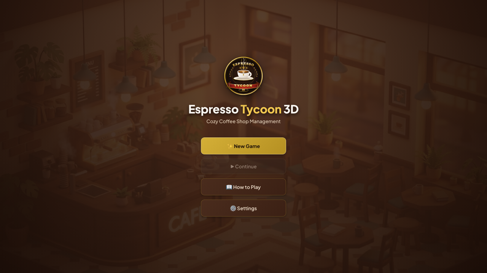
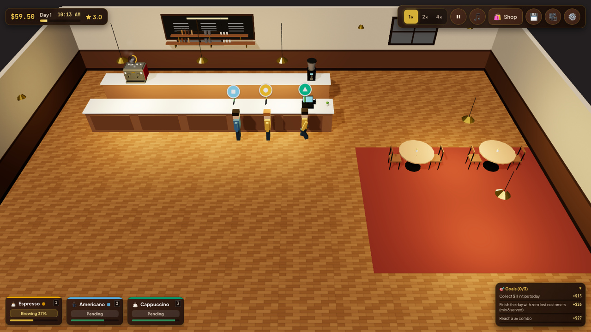
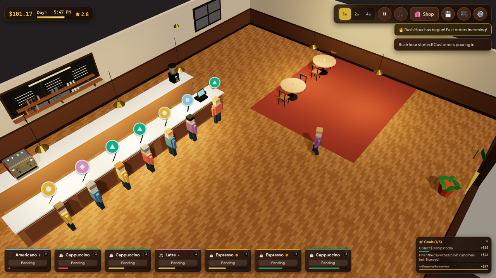
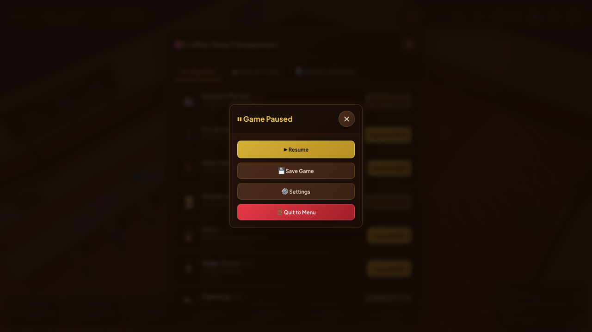

# ☕ Espresso Tycoon 3D

**Play in your browser:** https://katsugtgz.github.io/espresso-tycoon-3d/

Browser 3D coffee-shop tycoon. Vite + TypeScript + Three.js. No backend; saves in `localStorage`.



<table>
  <tr>
    <td align="center"><br/><sub><b>Main menu</b></sub></td>
    <td align="center"><br/><sub><b>Brew &amp; serve</b></sub></td>
  </tr>
  <tr>
    <td align="center"><br/><sub><b>Morning rush</b></sub></td>
    <td align="center"><br/><sub><b>Upgrades &amp; shop</b></sub></td>
  </tr>
</table>

## How to play

Customers walk in, queue at the register and order (espresso / americano / cappuccino / latte; mocha & cold brew unlockable).
Click an **espresso machine** → it brews the oldest pending order (progress ring). When ready (✓) click it again (or the counter / a ticket) to **serve** → money + tip. Fast serves build a **combo** (bigger tips). Customers whose patience runs out leave angry → rating drops.
Each day 08:00–20:00. Day end: rent + barista wages charged, summary shown, autosave. Negative money at two consecutive day ends → bankrupt (game over).

Shop: extra machines, pro grinder (faster brews), tables (seated guests tip more), baristas (auto brew/serve, daily wage), decor (rating ceiling/patience), bigger queue, marketing, drink unlocks, price tuning.

### Controls

| Input | Action |
|---|---|
| Click machine | brew oldest order / serve when ready |
| `1`–`6` | brew that drink on first free machine |
| `Space` | pause/resume |
| `Esc` | close panel / pause menu |
| `F` | fast-forward (1x→2x→4x) |
| `B` | shop |
| `R` | reset camera |
| `Ctrl/⌘+S` | save |
| Right-drag / `Q` `E` | rotate camera |
| Left-drag empty floor / middle-drag / `WASD` | pan |
| Wheel / pinch | zoom |

Settings: volumes, music toggle, graphics quality, colorblind-safe orders (Okabe-Ito colors + shapes), UI scale, reduced motion, FPS meter.

## Run

```bash
npm install
npm run dev        # http://localhost:5173
npm run build      # tsc + vite build -> dist/
npm run preview    # serve dist/
npm run eval       # autonomous Playwright bot evals (builds first)
npm run eval:quick # 1 seed, 2 days smoke
npx tsx scripts/sim-smoke.ts   # headless sim balance/determinism smoke
```

## Architecture

```
src/
  types.ts          shared contracts (GameState, GameAction, GameEvents, ISim, Settings)
  appTypes.ts       IRenderer, AppHooks, AppContext
  main.ts           bootstrap, main loop, autosave, auto-pause on blur, test-mode hook
  core/             events (typed bus), rng (seeded mulberry32), settings
  config/           layout (world positions shared by sim+renderer), balance (drinks, upgrades, tuning)
  sim/              pure deterministic simulation (no DOM): customers, stations, baristas, economy, progression, tutorial, save/migration
  render/           Three.js scene, procedural low-poly models, camera controls, picking, effects
  ui/               DOM HUD, shop, menus, tutorial, popups, keyboard, styles.css
  audio/            WebAudio synth SFX, ambient, generative lo-fi music
  testapi/          window.__game test API + invariant checker (only with ?test=1)
evals/              Playwright bots, scenarios, reports
public/assets/      logo, drink icons, textures, menu art
```

Sim is a fixed-step (1/30 s) deterministic state machine; all state lives in one serializable `GameState` (save = JSON). Renderer and UI only read state and dispatch `GameAction`s.

## How an agent plays / evaluates

1. Open `http://localhost:<port>/?test=1&seed=42` → `window.__game` appears (`window.__gameReady === true`).
2. Drive via `window.__game.actions.*` (`startGame`, `clickStation('machine:0')`, `brew('latte')`, `serve()`, `buyUpgrade('grinder')`, `setSpeed(4)`, `advanceTime(30)`, `pause(true)`, `save()`, `load()`, `nextDay()`), read `getState()`, `getEvents()`, `errors()`, `invariants.violations()`.
3. Same `seed` + same action sequence ⇒ identical state (determinism).
4. `npm run eval` runs every scenario in `evals/scenarios/*.json` (random-clicker fuzz, greedy, idle, upgrade-spammer, 10x speed-run, tutorial, keyboard, save/load, resize/blur, fps budget) across seeds, writes `evals/reports/<ts>.json|.md` (+ screenshots), exits non-zero on failure.
See [`evals/README.md`](evals/README.md) for the API reference & scenario format.
